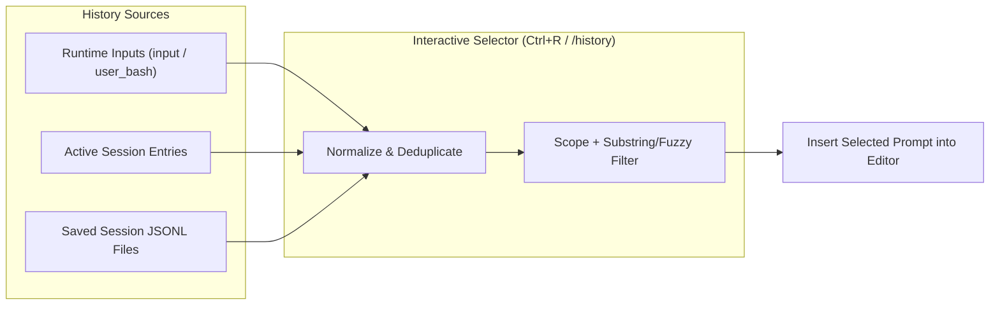

# Pi Prompt History

`pi-prompt-history` adds readline-style `Ctrl+R` reverse-search across your Pi
prompt history.

Pi's built-in `↑`/`↓` arrow history only browses prompts from the active
session. Starting a new session or switching branches leaves you retyping past
prompts, slash commands, and `!` shell invocations from memory.
`pi-prompt-history` indexes user prompts across your current session, current
project, and all saved sessions in `~/.pi/agent/sessions`, letting you filter
and reuse them in place.

## Requirements

- Pi 1.2.0+
- Node.js `>=24.6.0 <25`

## Installation

Install from Git:

```sh
pi install git:github.com/Integralist/pi-prompt-history
```

Or test locally in an isolated Pi session from this repository:

```sh
make try
```

## Usage

Press `Ctrl+R` in the main editor (or run `/history [query]`) to open the
interactive prompt history selector.

- If the editor already contains text when you press `Ctrl+R`, that text seeds
  the initial search query.
- If the current project has matching prompts, the selector opens in `Project`
  scope; otherwise it automatically falls back to `All` sessions.

### Keybindings

| Key                       | Action                                      |
| ------------------------- | ------------------------------------------- |
| `Ctrl+R`, `↓`, `Ctrl+N`   | Select next (older) match                   |
| `Ctrl+S`, `↑`, `Ctrl+P`   | Select previous (newer) match               |
| `PageDown` / `PageUp`     | Jump down or up one page                    |
| `Tab`                     | Cycle scope (`Project` → `All` → `Session`) |
| `Enter`                   | Insert selected prompt into editor          |
| `Esc`, `Ctrl+C`, `Ctrl+G` | Cancel and restore previous editor text     |

## How It Works



- **Prompt normalization**: Expanded `<skill>` blocks are compacted back to
  their `/skill:<name> [args]` invocation, and `!` / `!!` bash entries are
  restored with their prefix.
- **Deduplication**: Identical prompts are deduplicated to their most recent
  timestamp while retaining session and project membership.
- **Editor composition**: Wraps any existing custom editor component via
  `ctx.ui.getEditorComponent()` so extensions like `pi-skill-argument-hints`
  continue rendering alongside `Ctrl+R`.

## Development

```sh
# Install dependencies
make deps

# Run unit tests, typecheck, and extension load check
make verify

# Launch an interactive Pi session with this extension loaded
make try
```
